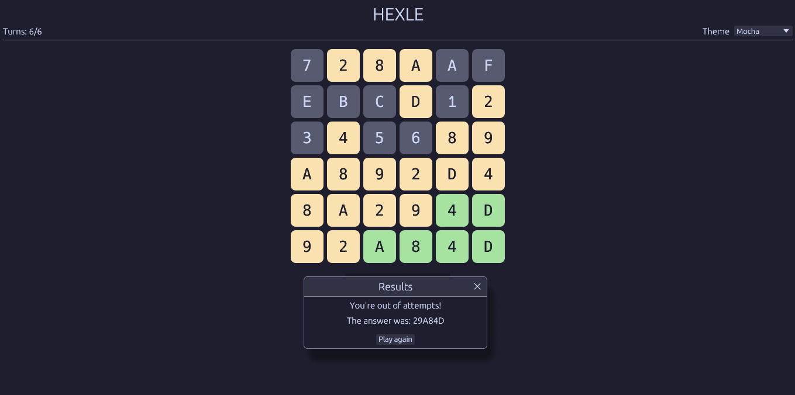

# Hexle
 
A Wordle-style game written in Rust with [egui](https://github.com/emilk/egui), themed with [Catppuccin](https://github.com/catppuccin/egui). Instead of a five-letter word, you guess a **6-digit hexadecimal number** (digits `0-9` and `A-F`) in **6 attempts**.




## How to play
 
- Type six hex digits (e.g. `3FA09C`) and press **Enter** or click **Guess**.
- After each guess every tile is coloured:
  - **Green**: the digit is correct and in the right position.
  - **Yellow**: the digit is in the number, but somewhere else.
  - **Grey**: the digit is not in the number, or every copy of it is already accounted for.
- Repeated digits follow Wordle's rules. If the target has one `A` and you guess `AAAAAA`, only one tile can be green or yellow.
- Click the **HEXLE** title for the About window. Pick one of the four Catppuccin themes (Latte, Frappé, Macchiato, Mocha) from the drop-down.
- When you win or run out of attempts, a results window reveals the answer and offers **Play again**.
## Running
 
```sh
cargo run --release
```
 
Dependencies: `eframe` / `egui`, `catppuccin-egui`, and `rand` 0.9 (for `random_range`). Use an egui version recent enough for `Context::content_rect` and `ComboBox::from_id_salt`, with a `catppuccin-egui` release built for that same egui version.
 
## Project layout
 
```
.
└── src
    ├── main.rs      # GUI: window, board drawing, input handling, themes
    └── hexle.rs     # Game logic: Board, Cell, Color (no UI code)
```
 
## Design
 
The code is split into two layers, so the game rules can be tested or reused (for example as a terminal game) without any GUI.
 
### `hexle.rs`: game logic.
 
| Item | Role |
| --- | --- |
| `TURNS`, `DIGITS` | Both `6`. Shared with the GUI so the board size is defined in one place. |
| `Color` | `Green`, `Yellow`, `Absent`: the score of one tile. |
| `Cell` | One scored tile: a digit (`u8`, 0 to 15) and its `Color`. |
| `Board` | Holds the secret `target`, the 6×6 grid of `attempts`, and `attempt_count`. |
| `Board::parse_attempt` | Validates user text (`3FA09C` or `3 F A 0 9 C`) and scores it. Returns `Result<bool, &str>`: `Ok(true)` means the guess was correct. |
| `Board::new_attempt` | Scores a guess and stores it as the next row. |
| `Board::cell(row, col)` | Read-only access for the GUI. Returns `None` for rows not guessed yet. |
| `impl Display for Board` | Prints the board in a terminal using ANSI colours. |
 
### `main.rs`: GUI
 
The `Hexle` struct owns a `Board` plus UI state: the current theme, the text being typed, the last error, and whether the results and about windows are open. It implements `eframe::App`, and `update()` runs every frame to draw everything. The game state never lives in the UI, and the UI only calls `Board`'s public methods.
 
### What happens on a guess
 
1. The text box keeps only hex digits, uppercased, up to 6 characters.
2. **Enter** or **Guess** calls `Hexle::submit()`, which ignores the guess if the game is already over.
3. `Board::parse_attempt` checks the length and that every character is a hex digit. On failure, the error is shown in red and no attempt is used.
4. `Board::new_attempt` scores the guess and stores it as the next row.
5. `submit()` clears the input and, if the player won or ran out of attempts, opens the results window.
6. On the next frame `draw_board()` reads `Board::cell(row, col)` and paints the tiles with the theme colours.
Scoring uses two passes so duplicate digits behave like Wordle:
 
1. Count the target digits that were *not* matched exactly. These are the only ones still available to turn yellow.
2. Walk the guess left to right. An exact match is green. Otherwise the tile is yellow if an unused copy of that digit remains (and the count is decremented), and grey if not.
## Credits
 
Inspired by [Jordan's version](https://hexle.vercel.app/) and [James' version](https://jamesl.me/hexle/index.html). Theme by [Catppuccin](https://github.com/catppuccin/egui).